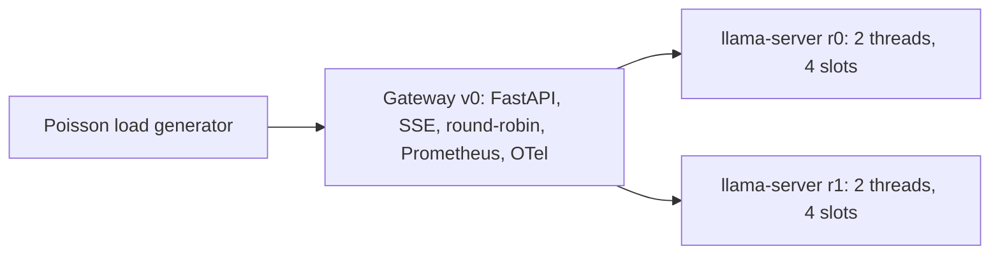

# llm-inference-gateway

An OpenAI-compatible gateway in front of self-hosted LLM replicas, built to answer three questions with measurements: how much each serving technique changes p95 time-to-first-token (TTFT) and goodput, how many replicas a workload needs, and what each optimization costs in quality. For teams self-hosting small open models on modest hardware.

**Status:** Phase 1 (baseline) done. Phase 2 partly done: prefix routing (negative result) and admission control (positive). Not started: gRPC control plane, semantic cache, quantization, cascade, perf model, eval, observability.



## Quickstart
```bash
make setup && make download      # venv, llama.cpp build, models, Bitext
make bench-baseline              # about 11 min on 4 vCPUs
```

## Baseline results (Qwen2.5-0.5B Q4_K_M, 4 vCPU Xeon, CPU only)
SLO: p95 TTFT <= 2.0 s ([ADR-002](docs/DECISIONS.md)). Single run per rate, 2026-11-05; full table and method in [results/RESUME_METRICS.md](results/RESUME_METRICS.md) and [docs/BENCHMARKS.md](docs/BENCHMARKS.md).

| measured req/s | p50 TTFT | p95 TTFT | p99 TTFT | goodput req/s |
|---|---|---|---|---|
| 0.55 | 0.62 s | 1.35 s | 1.74 s | 0.55 |
| 0.94 | 0.64 s | 1.54 s | 1.83 s | 0.93 |
| 1.57 | 1.52 s | 4.03 s | 4.17 s | 0.89 |
| 1.76 | 17.2 s | 27.7 s | 29.0 s | 0.19 |


## Phase 2 so far (baseline vs technique, details in [docs/DECISIONS.md](docs/DECISIONS.md))
| technique | metric | baseline | with technique |
|---|---|---|---|
| SLO admission control ([ADR-004](docs/DECISIONS.md)) | goodput @ nominal 3 rps | 0.24 req/s, p95 TTFT 16.2 s | 1.37 req/s, p95 2.52 s (22% rejected) |
| SLO admission control | goodput @ nominal 6 rps | 0.06 req/s, p95 29.8 s | 1.04 req/s, p95 7.13 s (39% rejected) |
| Prefix-aware routing ([ADR-003](docs/DECISIONS.md)) | prefill tokens/request @ 1 rps | 82.8 | 72.2, but p95 got worse: not claimed |

Single runs, no confidence intervals; clients do not retry after a 429.

## Limitations
- Sessions are synthetic: chained single-turn Bitext rows (see [docs/DATA.md](docs/DATA.md)).
- One run per rate, no confidence intervals. Replica threads are split by count, not pinned to cores.
- Docker/Kubernetes and GPU paths are **not verified in this environment**.
