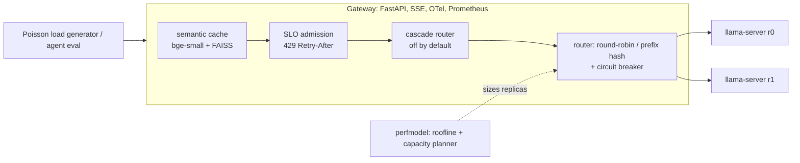
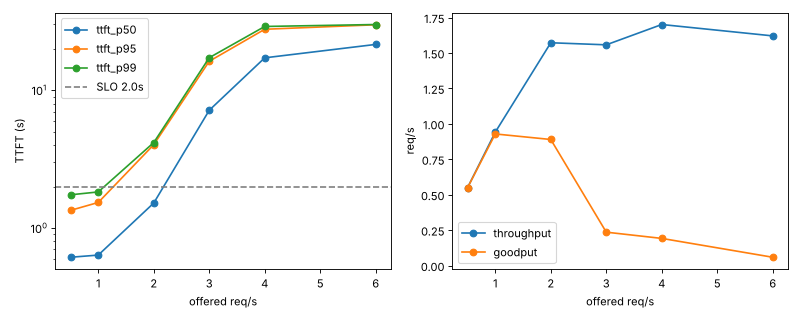

# llm-inference-gateway

An OpenAI-compatible gateway in front of self-hosted LLM replicas, plus a performance model and capacity planner, built to answer three
questions **with measurements from this repo**: how much each serving technique changes p95 time-to-first-token (TTFT) and goodput,
how many replicas a workload needs (predicted vs measured), and what the optimizations cost in answer quality.
For teams self-hosting small open models on modest hardware. Everything ran on one **4-vCPU Xeon @ 2.80GHz, 15 GiB RAM, no GPU**
(Qwen2.5-0.5B/1.5B Q4_K_M via llama.cpp). Anything that needs Docker, Kubernetes or a GPU is marked **not verified in this environment**.



## Quickstart
```bash
make setup && make download     # venv, llama.cpp build, GGUF models, Bitext, tau-bench retail data
make test                       # unit tests (CPU only, LLM mocked)
make bench-baseline             # baseline sweep (~11 min)
make perfmodel                  # predicted vs measured table
make eval                       # support-agent quality eval (~15 min)
```
`make bench-ablation` reruns every Phase 2 A/B (about 1 h). The Make targets were assembled from scripts that were each run directly; the
`make` wrappers themselves were not run end to end.

## Results (all numbers: single runs, no confidence intervals; sources and commands in [results/RESUME_METRICS.md](results/RESUME_METRICS.md))
SLO = p95 TTFT <= 2.0 s. Baseline = round-robin, 2 replicas of Qwen2.5-0.5B Q4_K_M, 2 threads each.

| technique | metric | baseline | with technique | verdict |
|---|---|---|---|---|
| (baseline) saturation | completed req/s | 1.6-1.7 req/s; p95 TTFT 1.5 s at 0.94 req/s, 29.8 s at overload | | reference curve |
| SLO admission control ([ADR-004](docs/DECISIONS.md)) | goodput @ nominal 3 / 6 req/s | 0.24 / 0.06 req/s | 1.37 / 1.04 req/s (22% / 39% rejected) | **helps under overload** |
| Semantic cache ([ADR-005](docs/DECISIONS.md)) | goodput, p95 TTFT @ nominal 2 req/s | 0.89 req/s, 4.03 s | 1.55 req/s, 1.42 s (32% of LLM calls avoided) | **helps at saturation**, not at light load |
| Prefix-aware routing ([ADR-003](docs/DECISIONS.md)) | prefill tokens/request @ 1 req/s | 82.8 | 72.2, but p95 TTFT 1.74 -> 2.29 s | inconclusive, off |
| Model cascade ([ADR-008](docs/DECISIONS.md)) | p95 TTFT @ 0.5 req/s vs always-1.5B | 3.55 s | 8.21 s (rule router) | **negative**, off |
| gRPC control plane ([ADR-007](docs/DECISIONS.md)) | staleness, CPU | HTTP polling: same staleness | 160x fewer bytes, no CPU saving | no benefit, unused |
| Quantization ([ADR-006](docs/DECISIONS.md)) | decode tok/s, 0.5B | F16 13.8 | Q4_K_M 25.0 (Q8_0 20.5) | Q4_K_M chosen (speed/memory) |
| Admission + cache combined ([ADR-009](docs/DECISIONS.md)) | goodput @ 3 req/s | admission alone 1.37 | 0.99 | **not additive** |



**Quality cost ([ADR-011](docs/DECISIONS.md))** on 24 tau-bench-style retail tasks (tau-bench database/policy, tasks generated here): the
models are too weak for the lookup/cancel tasks (0/8 for every config, including 1.5B), so only the 8 policy questions discriminate:
0.5B 1/8 vs 1.5B 4/8 correct; Q4_K_M/Q8_0/F16 identical at 0.5B. **n = 8, differences between quantizations are not significant**, and
the semantic cache received 0 eligible hits in the agent eval, so its quality cost is unmeasured.

## Predict before you buy hardware
`python -m perfmodel.planner --rate 1.0 --slo 2.0` -> "3 replicas x 2 threads (predicted p95 1.99 s)". How far to trust it ([ADR-010](docs/DECISIONS.md)):
- Roofline model (prefill compute-bound, decode memory-bound) from a 12.4 GB/s triad and 231 GFLOP/s GEMM microbenchmark. After one refinement
  fitted on 0.5B only, **decode error on the held-out 1.5B model fell from 98% to 5%; prefill error did not transfer (31% -> 38%)**.
- Planner = service-time model + Monte Carlo queue. Predicted saturation 1.68 req/s vs measured 1.6-1.7 (calibrated on it), but p95 TTFT at
  three measured operating points is over-predicted by **+58%, +67%, +291%**: it is pessimistic (over-provisions), the safe direction, but not accurate.
- Gateway overhead (mock upstream, 40 req/s): **+3.8 ms p50 / +9.5 ms p95 TTFT**, under 2% of a real TTFT; flamegraph in `results/gateway_flamegraph.svg`.

## Observability and incident drill
SLO "99% of requests TTFT <= 2 s over 30 days", multi-window burn-rate alerts, OTel spans, Prometheus metrics, compose/k8s files
(**not verified in this environment**). A fault-injection drill (kill a replica, then throttle one) is written up in
[docs/INCIDENT_DRILL.md](docs/INCIDENT_DRILL.md): error alert fires 0.3 s after a kill; a throttled replica is only caught by the burn alert
(18.7-30.7 s later) and traces isolate it (15.3 s vs 0.63 s mean TTFT). A passive circuit breaker cut kill-window errors 51.7% -> 27.8% (n=29 vs 36).

## GPU notebooks (written, **not run**: no GPU here)
`notebooks/gpu_serving_benchmark.ipynb` (vLLM on a free T4, perf-model second hardware profile, cost per 1k requests) and
`notebooks/router_lora_finetune.ipynb` (LoRA router/intent classifier vs prompt-only router, GGUF export). Each states its runtime and writes a results JSON to commit back.

## Limitations
- Synthetic sessions (chained single-turn Bitext rows); tau-bench-style tasks are not the official tau-bench tasks.
- Single runs, small samples, one machine; the nominal arrival rate differs from the measured rate (see [docs/BENCHMARKS.md](docs/BENCHMARKS.md)).
- Admission control can shed all LLM traffic when its EWMA estimate is inflated (ADR-009); clients never retry after a 429 in the load generator.
- No health-aware routing for slow (gray-failing) replicas; Prometheus/Grafana/Docker/Kubernetes and the GPU notebooks were not executed here.
- Phase 7 (voice front-end) was **not started** (heavy ML dependencies; the Could tier was dropped to protect budget).
- Details of every decision, including the negative results, are in [docs/DECISIONS.md](docs/DECISIONS.md); data and licenses in [docs/DATA.md](docs/DATA.md).
